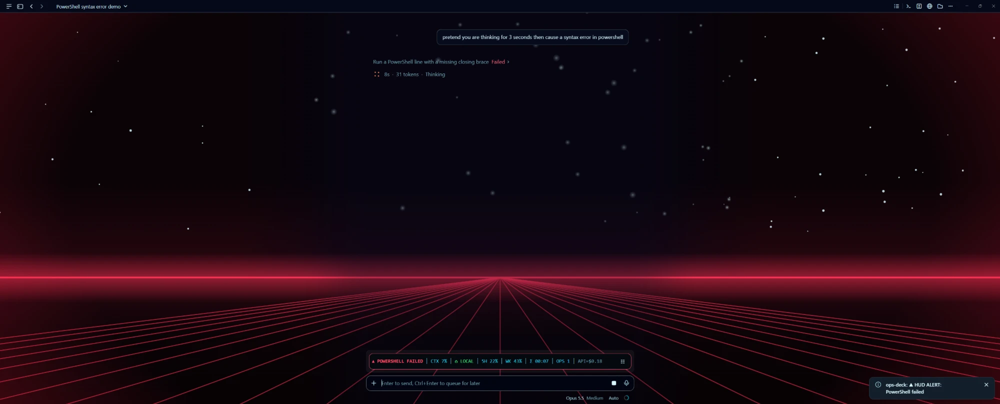

<p align="center">
  
</p>

<p align="center">
  <a href="README.md">English</a> · <a href="README.el.md">Ελληνικά</a> · <a href="README.de.md">Deutsch</a> · <b>Français</b> · <a href="README.es.md">Español</a> · <a href="README.it.md">Italiano</a> · <a href="README.pt.md">Português</a> · <a href="README.zh.md">简体中文</a> · <a href="README.ja.md">日本語</a> · <a href="README.ar.md">العربية</a>
</p>

<p align="center">
  Un HUD de science-fiction pour l’application Claude sur ordinateur.<br>Des fonds animés qui montrent ce que fait Claude, une bande d’état au-dessus du prompt<br>et un tableau de bord qui dit ce qui a quitté votre PC.
</p>





> **Un projet perso, fait pour le plaisir.** Utilisez-le tel quel : aucune garantie qu’il fonctionne partout et aucune promesse de support. Cela dit, je répondrai volontiers à chaque message sympathique, et je suis toujours prêt à changer, ajouter ou corriger des choses. [Ouvrez une issue](https://github.com/leoplusma/ops-deck/issues) pour dire bonjour.

## Ce qu’il fait

- **Neuf fonds animés** : cinq sombres (circuit, horizon, data room, code rain, signal) et quatre clairs (ink plotter, halftone tide, digital cream, heartline). Une scène claire passe aussi l’application, la bande et le tableau de bord en couleurs claires. Une couleur indique ce que fait Claude : **violet** réflexion, **ambre** fichiers, **vert** commandes, **magenta** web. Tout passe au **rouge** quand un outil échoue.
- **Deux choix immobiles** qui suivent le réglage clair ou sombre de l’application : **spotlight**, un fond de studio calme (bleu-noir ou ivoire), et **None**, une couleur unie (bleu nuit ou crème). Dans la liste des scènes : ☾ sombre, ☀ claire, ◐ suit l’application.
- **Bande d’état** au-dessus du prompt : contexte, utilisation du forfait (5 heures et semaine), temps, appels d’outils, estimation du coût.
- **Tableau de bord** : ce qui a quitté votre PC, graphe des fichiers, outils, sous-agents, tours récents, aide et un onglet de démo.
- **Dix langues.** Tout reste sur votre PC : ops-deck n’envoie rien nulle part.

## Prérequis

Une version récente de l’application Claude (testé avec Claude Code 2.1.325 sous Windows 11).

**Git** doit être installé (Claude s’en sert pour télécharger le plugin). Sous Windows : [Git for Windows](https://git-scm.com/download/win), avec les options par défaut.

## Installation

**Le plus simple :** demandez-le à Claude dans une session de l’application, il fait toutes les étapes lui-même :

```
Install the plugin ops-deck from the GitHub marketplace leoplusma/ops-deck for my user, using the claude CLI the desktop app bundles
```

**Dans l’application :** **+** à côté de la zone de saisie → **Plugins** → **Add marketplace** → `leoplusma/ops-deck` → **Add plugin**.

**Ou dans un terminal** (`claude`) :

```
/plugin install ops-deck --marketplace leoplusma/ops-deck
```

Ouvrez une nouvelle session ou tapez `/reload-plugins`. Au départ : fond activé, scène **horizon**, langue anglaise (modifiable dans le tableau de bord, mémorisée).

## Si les fonds ne bougent pas

Les fonds changent de couleur selon le travail de Claude, mais ils doivent aussi bouger et apparaître en fondu. S’ils restent immobiles, vérifiez dans l’ordre :

1. **Animations de Windows activées :** **Paramètres › Accessibilité › Effets visuels › Effets d’animation**. Et dans **Paramètres système avancés › Performances**, « Animer les contrôles et les éléments à l’intérieur des fenêtres » coché.
2. **Dans une machine virtuelle** (VMware, Hyper-V, VirtualBox…) : activez les graphismes 3D (VMware : **VM › Settings › Display › Accelerate 3D graphics**) et installez les outils invités (VMware Tools).
3. **Toujours immobiles ?** L’application se méfie souvent du pilote graphique d’une VM et dessine sans accélération matérielle. Quittez complètement Claude (y compris l’icône près de l’horloge) et lancez-le depuis PowerShell avec l’option `--ignore-gpu-blocklist` :

```powershell
& (Join-Path (Get-AppxPackage -Name Claude).InstallLocation 'app\Claude.exe') --ignore-gpu-blocklist
```

Ou créez un raccourci **Claude (VM)** sur le bureau qui le lance toujours ainsi (il fonctionne aussi après les mises à jour) :

```powershell
$s = (New-Object -ComObject WScript.Shell).CreateShortcut("$([Environment]::GetFolderPath('Desktop'))\Claude (VM).lnk"); $s.TargetPath = "$env:WINDIR\System32\WindowsPowerShell\v1.0\powershell.exe"; $s.Arguments = '-NoProfile -WindowStyle Hidden -Command "& (Join-Path (Get-AppxPackage -Name Claude).InstallLocation ''app\Claude.exe'') --ignore-gpu-blocklist"'; $s.WindowStyle = 7; $s.IconLocation = (Join-Path (Get-AppxPackage -Name Claude).InstallLocation 'app\Claude.exe'); $s.Save()
```

## Quelque chose ne marche pas ?

Tapez `/hud-debug` dans une session, ou demandez à Claude *"ops-deck debug"*. Vous obtenez un court rapport : ce qu’ops-deck a enregistré (fond, scène, tableau de bord), ce qu’il a dessiné en dernier et comment s’est passé son démarrage. Le même rapport est aussi écrit dans `debug.txt`, dans le dossier du plugin.

Pour signaler un problème, [ouvrez une issue](https://github.com/leoplusma/ops-deck/issues) et collez-y le rapport. Relisez-le d’abord : il contient le modèle et l’usage de la session, et peut-être son dossier.

## Désactiver ou supprimer

Désactiver : `/plugin disable ops-deck@ops-deck`

Supprimer : `/plugin uninstall ops-deck@ops-deck`, `/plugin marketplace remove ops-deck`

Tous les détails et les images des scènes et du tableau de bord : [README en anglais](README.md).

## Licence

[MIT](LICENSE) : libre d’utiliser, modifier et partager, fourni tel quel, sans garantie.
