<p align="center">
  
</p>

<p align="center">
  <b>English</b> · <a href="README.el.md">Ελληνικά</a> · <a href="README.de.md">Deutsch</a> · <a href="README.fr.md">Français</a> · <a href="README.es.md">Español</a> · <a href="README.it.md">Italiano</a> · <a href="README.pt.md">Português</a> · <a href="README.zh.md">简体中文</a> · <a href="README.ja.md">日本語</a> · <a href="README.ar.md">العربية</a>
</p>

<p align="center">
  A sci-fi heads-up display for the Claude desktop app.<br>
  Animated backgrounds that show what Claude is doing, a status band above the prompt,<br>
  and a session dashboard that tells you what left your PC.
</p>


> **A hobby project made for fun.** Use it as it is: there's no guarantee it works everywhere and no promise of support. That said, I'll gladly answer every friendly message, and I'm always open to changing, adding or fixing things. [Open an issue](https://github.com/leoplusma/ops-deck/issues) to say hello.

## What it does

- **Five animated backgrounds** (circuit, horizon, data room, code rain, signal) that fade in while Claude works and fade out when it's done. One colour tells you what Claude is doing right now: **violet** thinking, **amber** working with files, **green** running commands, **magenta** reaching the web. Everything turns **red** when a tool fails.
- **A status band above the prompt**: working or idle, context used, 5-hour and weekly plan usage, time worked, tool calls and an API cost estimate. It flashes green on a clean finish and turns red on a failure.
- **A session dashboard** in the side pane:
  - **What left this PC**: every web or network place a tool call reached, with the exact command, and the tries a hook blocked.
  - **Files touched**: a graph grouped by folder (click to zoom) and a list with how often each file was read, edited or written.
  - **Tools used**: calls per tool, failures, and the whole last command with a Copy button.
  - **Subagents**: a timeline coloured by model (Opus, Sonnet, Haiku, ...) and a fact sheet for each helper: what it was asked, its report, its tools.
  - **Recent turns**, a built-in **help**, and a **demo tab** with a made-up session.
- **Ten languages**: English, Ελληνικά, Deutsch, Français, Español, Italiano, Português, 简体中文, 日本語 and العربية (right to left).

Everything runs on your PC. ops-deck sends nothing anywhere; it only shows what Claude Code already reports.

## Requirements

A recent Claude desktop app (tested with Claude Code 2.1.325 on Windows 11). Older versions without mod support won't load it. The moving backgrounds and graphs need the desktop app; in a terminal you get the band and a text dashboard. The Explorer, Copy and session-name features use PowerShell, so they need Windows.

**Made for dark mode.** It doesn't look right in the app's light mode yet; light mode support may come soon.

**Git** must be installed (Claude uses it to download the plugin). On Windows: [Git for Windows](https://git-scm.com/download/win), default options.

## Install

**The easy way:** ask Claude in a desktop app session, and it does every step itself:

```
Install the plugin ops-deck from the GitHub marketplace leoplusma/ops-deck for my user, using the claude CLI the desktop app bundles
```

**In the desktop app:** click **+** next to the prompt box, then **Plugins** → **Add marketplace** → `leoplusma/ops-deck` → **Add plugin** (ops-deck).

**Or in a terminal session** (`claude`):

```
/plugin install ops-deck --marketplace leoplusma/ops-deck
```

Answer `y` to add the marketplace, then pick the user scope with Enter. Open a new session, or type `/reload-plugins` in an open one.

On first run the background is on with the **horizon** scene, the language is **English**, and the dashboard opens by itself. Whatever you change is remembered.

## If the backgrounds don't move

The backgrounds change colour with Claude's work, but they should also move and fade in and out. If they stand still, check these in order:

1. **Windows animations on:** **Settings › Accessibility › Visual effects › Animation effects**. Also, under **Advanced system settings › Performance**, keep "Animate controls and elements inside windows" ticked.
2. **In a virtual machine** (VMware, Hyper-V, VirtualBox…): turn on its 3D graphics (VMware: **VM › Settings › Display › Accelerate 3D graphics**) and install its guest tools (VMware Tools).
3. **Still standing still?** The app often doesn't trust a virtual machine's display driver and draws without hardware graphics. Quit Claude completely (the tray icon by the clock too) and start it from PowerShell with the `--ignore-gpu-blocklist` switch:

```powershell
& (Join-Path (Get-AppxPackage -Name Claude).InstallLocation 'app\Claude.exe') --ignore-gpu-blocklist
```

Or make a **Claude (VM)** shortcut on the desktop that always starts it that way (it keeps working after updates):

```powershell
$s = (New-Object -ComObject WScript.Shell).CreateShortcut("$([Environment]::GetFolderPath('Desktop'))\Claude (VM).lnk"); $s.TargetPath = "$env:WINDIR\System32\WindowsPowerShell\v1.0\powershell.exe"; $s.Arguments = '-NoProfile -WindowStyle Hidden -Command "& (Join-Path (Get-AppxPackage -Name Claude).InstallLocation ''app\Claude.exe'') --ignore-gpu-blocklist"'; $s.WindowStyle = 7; $s.IconLocation = (Join-Path (Get-AppxPackage -Name Claude).InstallLocation 'app\Claude.exe'); $s.Save()
```

## Use

- Pick a **scene** and a **language** at the top of the dashboard. **Help** explains every colour and mark.
- Or ask Claude: *"open the ops-deck dashboard"*, *"close the ops-deck dashboard"*, *"ops-deck scene signal"*, *"ops-deck background off"*, *"open the ops-deck demo"*.

## Turn it off or remove it

| You want | Do this |
|---|---|
| A calmer screen | Pick **None** in the Scene list (or ask *"ops-deck background off"*); close the dashboard. The band and colours stay. |
| ops-deck off, kept installed | `/plugin disable ops-deck@ops-deck` (back on: `/plugin enable ops-deck@ops-deck`), or manage it under **+ › Plugins** in the desktop app. |
| ops-deck gone | `/plugin uninstall ops-deck@ops-deck`, then `/plugin marketplace remove ops-deck`. |

Then open a new session or type `/reload-plugins`.

## Scenes

| | Working | Error |
|---|---|---|
| **circuit** |  |  |
| **horizon** | 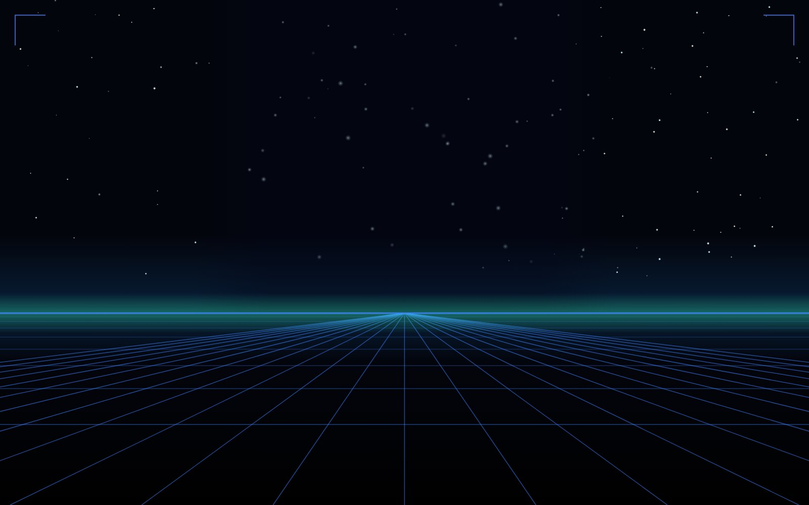 | 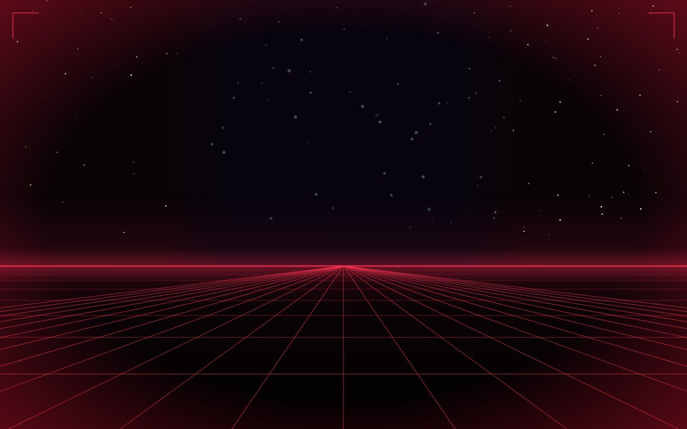 |
| **data room** | 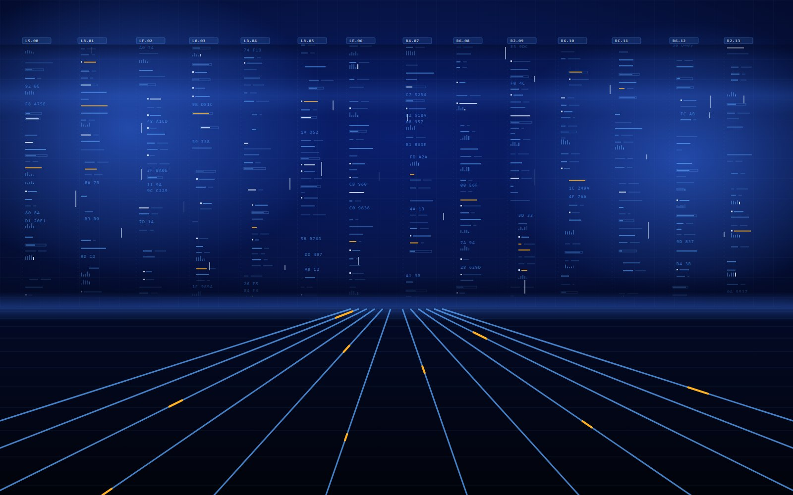 | 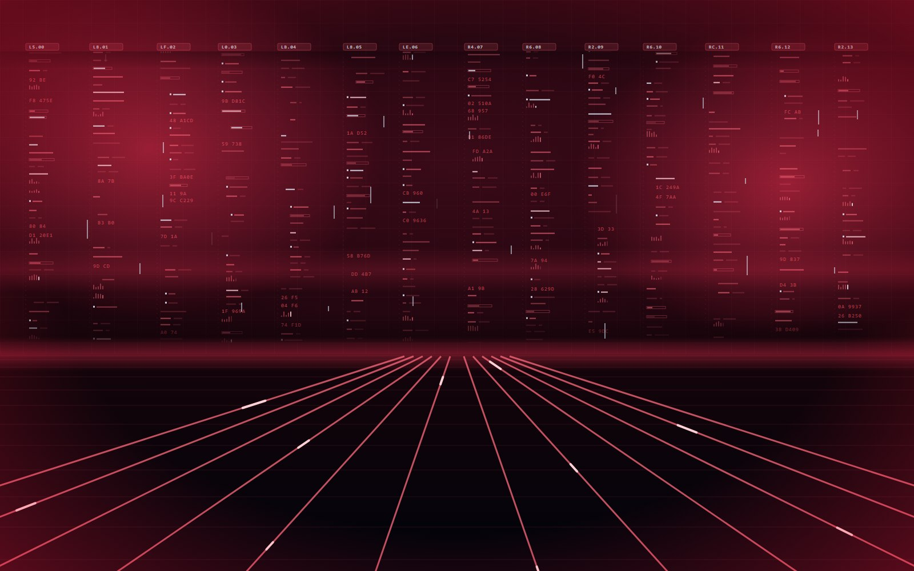 |
| **code rain** | 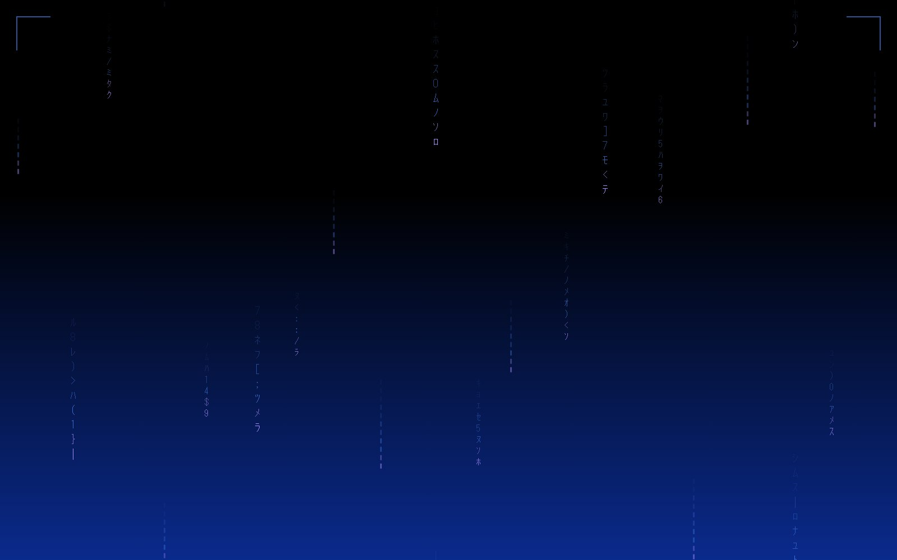 | 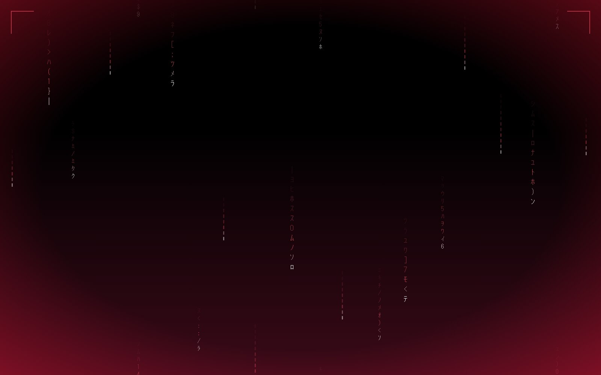 |
| **signal** | 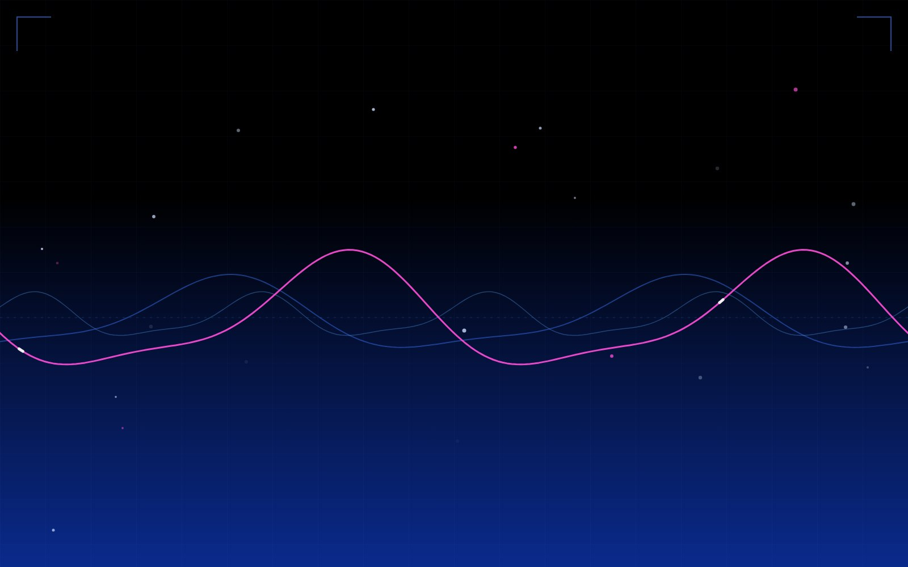 | 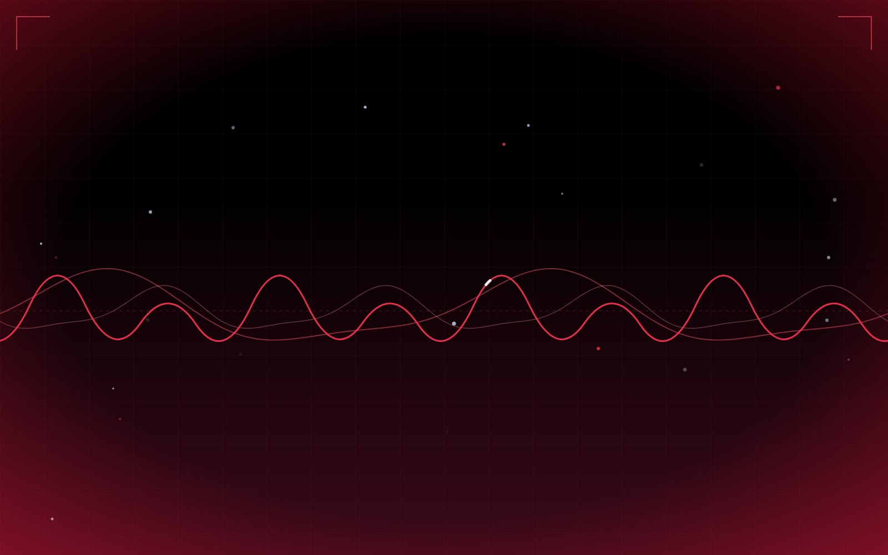 |

## The dashboard

All four pictures are from the demo tab, with a made-up session.

| Overview | Files |
|---|---|
| 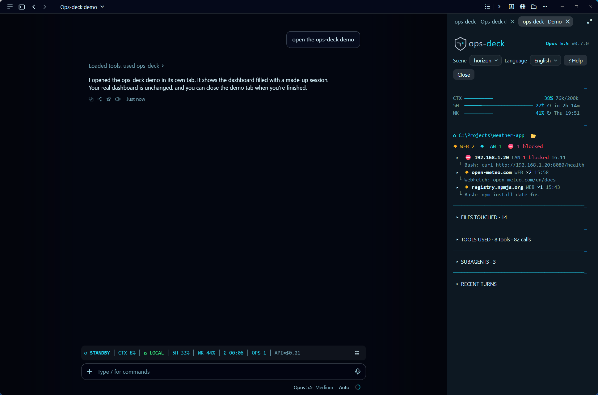 | 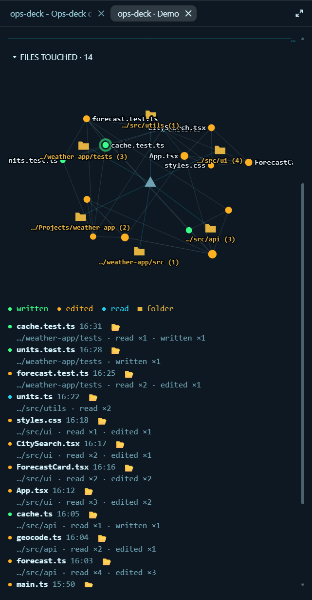 |
| **Network and tools** | **Subagents and recent turns** |
| 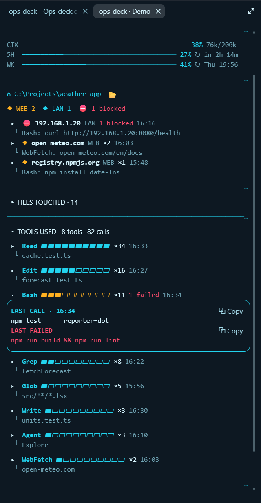 | 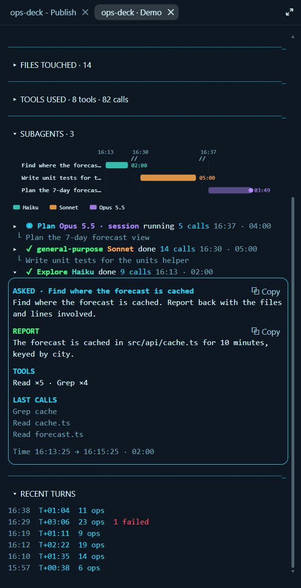 |

## Credits

- **Concept & direction:** Minas N. Miliaras
- **Code:** Claude Opus 5.5
- **Logo:** Grok 4.6
- `hooks/make-colors.js` is the theme helper from Anthropic's Claude Code mod tools, included as provided.

## Licence

[MIT](LICENSE): free to use, change and share, provided as is, without warranty.
