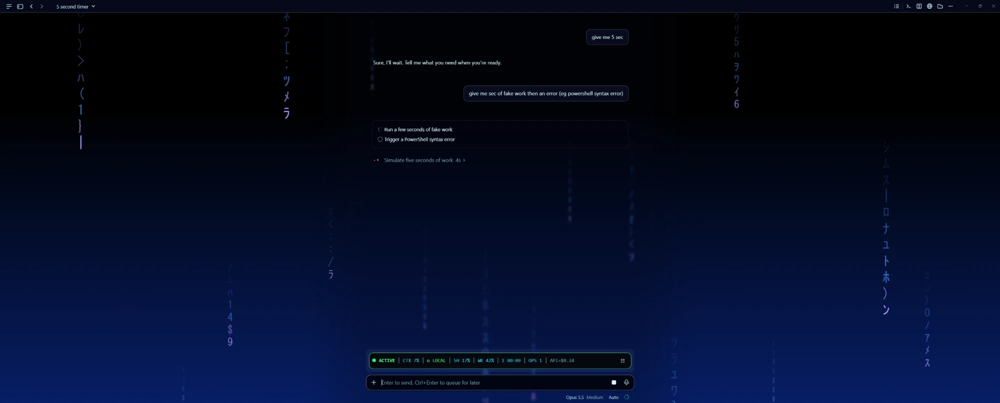

<p align="center">
  
</p>

<p align="center">
  <a href="README.md">English</a> · <a href="README.el.md">Ελληνικά</a> · <a href="README.de.md">Deutsch</a> · <a href="README.fr.md">Français</a> · <a href="README.es.md">Español</a> · <a href="README.it.md">Italiano</a> · <b>Português</b> · <a href="README.zh.md">简体中文</a> · <a href="README.ja.md">日本語</a> · <a href="README.ar.md">العربية</a>
</p>

<p align="center">
  Um HUD de ficção científica para o app de desktop do Claude.<br>Fundos animados que mostram o que o Claude está fazendo, uma faixa de status acima do prompt<br>e um painel de sessão que mostra o que saiu do seu PC.
</p>




> **Um projeto pessoal feito por diversão.** Use como está: não há garantia de que funcione em todo lugar nem promessa de suporte. Dito isso, vou responder com prazer a toda mensagem amigável e estou sempre aberto a mudar, acrescentar ou consertar coisas. [Abra uma issue](https://github.com/leoplusma/ops-deck/issues) para dizer olá.

## O que faz

- **Cinco fundos animados** (circuit, horizon, data room, code rain, signal). Uma cor mostra o que o Claude faz: **violeta** pensando, **âmbar** arquivos, **verde** comandos, **magenta** web. Tudo fica **vermelho** quando uma ferramenta falha.
- **Faixa de status** acima do prompt: contexto, uso do plano (5 horas e semana), tempo, chamadas de ferramentas, custo estimado.
- **Painel de sessão**: o que saiu do seu PC, gráfico de arquivos, ferramentas, subagentes, rodadas recentes, ajuda e uma aba de demonstração.
- **Dez idiomas.** Tudo fica no seu PC: o ops-deck não envia nada para lugar nenhum.

## Requisitos

Uma versão recente do app de desktop do Claude (testado com Claude Code 2.1.325 no Windows 11). Os fundos animados precisam de **Configurações › Acessibilidade › Efeitos visuais › Efeitos de animação** ativado no Windows.

**Feito para o modo escuro.** No modo claro do app ainda não fica bom; o suporte ao modo claro pode chegar em breve.

É preciso ter o **Git** instalado (o Claude usa para baixar o plugin). No Windows: [Git for Windows](https://git-scm.com/download/win), com as opções padrão.

**Em uma máquina virtual** (VMware, Hyper-V, VirtualBox…) os fundos mudam de cor mas ficam parados, porque o app desliga a aceleração gráfica em muitos drivers virtuais. Feche o Claude por completo (inclusive o ícone ao lado do relógio) e abra-o com `claude.exe --ignore-gpu-blocklist`.

## Instalação

**O jeito mais fácil:** peça ao Claude numa sessão do app, e ele faz todos os passos sozinho:

```
Install the plugin ops-deck from the GitHub marketplace leoplusma/ops-deck for my user, using the claude CLI the desktop app bundles
```

**No app:** **+** ao lado da caixa do prompt → **Plugins** → **Add marketplace** → `leoplusma/ops-deck` → **Add plugin**.

**Ou numa sessão de terminal** (`claude`):

```
/plugin install ops-deck --marketplace leoplusma/ops-deck
```

Abra uma nova sessão ou digite `/reload-plugins`. No início: fundo ativo, cena **horizon**, idioma inglês (muda no painel e fica salvo).

## Desativar ou remover

Desativar: `/plugin disable ops-deck@ops-deck`

Remover: `/plugin uninstall ops-deck@ops-deck`, `/plugin marketplace remove ops-deck`

Todos os detalhes e as imagens das cenas e do painel: [README em inglês](README.md).

## Licença

[MIT](LICENSE): livre para usar, alterar e compartilhar, como está, sem garantia.
