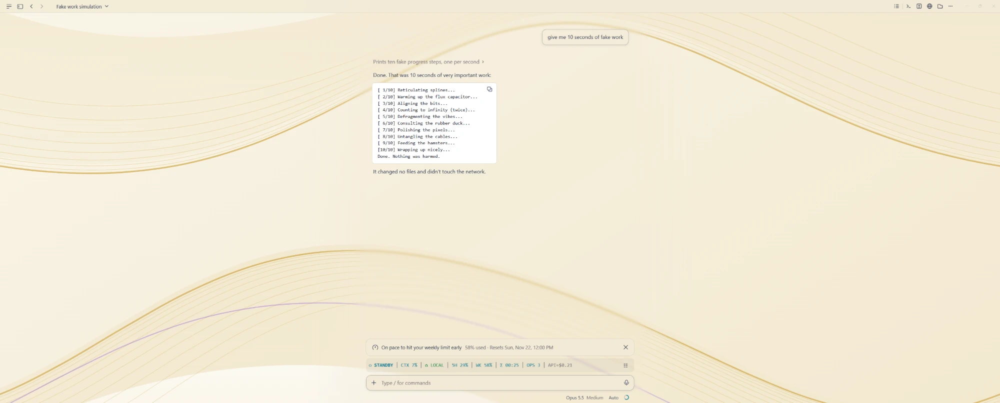

<p align="center">
  
</p>

<p align="center">
  <a href="README.md">English</a> · <a href="README.el.md">Ελληνικά</a> · <a href="README.de.md">Deutsch</a> · <a href="README.fr.md">Français</a> · <a href="README.es.md">Español</a> · <a href="README.it.md">Italiano</a> · <a href="README.pt.md">Português</a> · <b>简体中文</b> · <a href="README.ja.md">日本語</a> · <a href="README.ar.md">العربية</a>
</p>

<p align="center">
  为 Claude 桌面应用打造的科幻风 HUD。<br>动画背景显示 Claude 正在做什么，输入框上方有状态条，<br>会话仪表板告诉你哪些内容离开了你的电脑。
</p>




> **一个为了好玩而做的业余项目。** 请按原样使用：不保证在所有环境都能运行，也不承诺提供支持。不过，我很乐意回复每一条友好的消息，也随时愿意修改、添加或修复功能。 [提交一个 issue](https://github.com/leoplusma/ops-deck/issues) 来打个招呼。

## 功能

- **九个动画背景**：五个深色 (circuit, horizon, data room, code rain, signal) 和四个浅色 (ink plotter, halftone tide, digital cream, heartline)。选择浅色场景时，应用、状态栏和仪表板也会切换为浅色。一种颜色显示 Claude 正在做什么：**紫色** 思考，**琥珀色** 处理文件，**绿色** 运行命令，**品红色** 访问网络。工具失败时整个画面变为 **红色**。
- **两个静止选项**，跟随应用自身的浅色或深色设置：**spotlight**，安静的影棚背景（蓝黑或象牙色）；**None**，单一纯色（夜蓝或奶油色）。场景列表中：☾ 深色，☀ 浅色，◐ 跟随应用。
- 输入框上方的 **状态条**：上下文、5 小时与每周套餐用量、时间、工具调用次数、估算费用。
- **会话仪表板**：离开电脑的内容、文件图、工具、子代理、最近的轮次、帮助和演示标签页。
- **十种语言。** 一切都在本机运行：ops-deck 不会向任何地方发送数据。

## 要求

较新版本的 Claude 桌面应用（已在 Windows 11 上用 Claude Code 2.1.325 测试）。

需要安装 **Git**（Claude 用它来下载插件）。Windows 上请安装 [Git for Windows](https://git-scm.com/download/win)，使用默认选项即可。

## 安装

**最简单的方法：**在应用的会话中让 Claude 来做，它会自己完成所有步骤：

```
Install the plugin ops-deck from the GitHub marketplace leoplusma/ops-deck for my user, using the claude CLI the desktop app bundles
```

**在桌面应用中：** 点击输入框旁的 **+** → **Plugins** → **Add marketplace** → `leoplusma/ops-deck` → **Add plugin**。

**或在终端会话中**（`claude`）：

```
/plugin install ops-deck --marketplace leoplusma/ops-deck
```

打开新会话，或输入 `/reload-plugins`。初始设置：背景开启，场景 **horizon**，语言为英语（可在仪表板中更改并会被记住）。

## 如果背景不动

背景会随 Claude 的工作变色，同时也应该移动并淡入淡出。如果它们静止不动，请依次检查：

1. **Windows 动画已开启：** **设置 › 辅助功能 › 视觉效果 › 动画效果**。另外在 **高级系统设置 › 性能** 中勾选“在窗口内部动画控件和元素”。
2. **在虚拟机中**（VMware、Hyper-V、VirtualBox…）：开启 3D 图形（VMware：**VM › Settings › Display › Accelerate 3D graphics**），并安装客户机工具（VMware Tools）。
3. **仍然不动？** 应用常常不信任虚拟机的显卡驱动，会在没有硬件加速的情况下绘制。请完全退出 Claude（包括时钟旁的托盘图标），然后在 PowerShell 中用 `--ignore-gpu-blocklist` 开关启动：

```powershell
& (Join-Path (Get-AppxPackage -Name Claude).InstallLocation 'app\Claude.exe') --ignore-gpu-blocklist
```

或者在桌面创建一个始终这样启动的快捷方式 **Claude (VM)**（更新后仍然有效）：

```powershell
$s = (New-Object -ComObject WScript.Shell).CreateShortcut("$([Environment]::GetFolderPath('Desktop'))\Claude (VM).lnk"); $s.TargetPath = "$env:WINDIR\System32\WindowsPowerShell\v1.0\powershell.exe"; $s.Arguments = '-NoProfile -WindowStyle Hidden -Command "& (Join-Path (Get-AppxPackage -Name Claude).InstallLocation ''app\Claude.exe'') --ignore-gpu-blocklist"'; $s.WindowStyle = 7; $s.IconLocation = (Join-Path (Get-AppxPackage -Name Claude).InstallLocation 'app\Claude.exe'); $s.Save()
```

## 遇到问题？

在会话中输入 `/hud-debug`，或让 Claude 执行 *"ops-deck debug"*。你会得到一份简短报告：ops-deck 保存了什么（背景、场景、仪表板）、最后绘制了什么，以及启动情况。同样的报告也会写入插件文件夹中的 `debug.txt`。

要报告问题，请[提交 issue](https://github.com/leoplusma/ops-deck/issues) 并粘贴报告。请先检查一遍：其中包含会话的模型和用量，可能还有它的文件夹。

## 关闭或卸载

关闭： `/plugin disable ops-deck@ops-deck`

卸载： `/plugin uninstall ops-deck@ops-deck`, `/plugin marketplace remove ops-deck`

全部细节以及场景和仪表板的图片：[英文 README](README.md)。

## 许可证

[MIT](LICENSE)：可自由使用、修改和分享，按原样提供，不附带任何担保。
